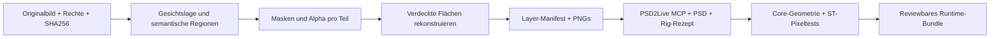

# Phase 1 — automatisch erzeugter, sichtbar animierbarer Test-Rig

Historischer Prüfstand: 2026-11-02, Commit `07f56b3`. Die folgenden Messwerte
stammen aus Phase 1 und wurden beim Cleanup nicht neu im Browser gemessen.
Rohbelege liegen nur noch lokal unter `docs/evidence/phase1/`; im ursprünglichen
Commit bleiben sie nachvollziehbar. Neue Läufe gehören nach `runs/`.

Prüfdatum: 2026-11-02. Phase 0 wurde vorher als `fed38dc` committed.
**Phase 1 besteht den funktionalen Rig-/Runtime-Test für die geometrische
Gesichtsvorlage.** Die unveränderte installierte SillyTavern-Erweiterung lädt
das Modell, rendert unabhängiges Blinzeln, Mundöffnung, Kopfbewegungen und
drei unterschiedliche Expressions. Eine selbst erstellte Idle-Motion läuft.
Dies ist kein Qualitätsnachweis für beliebige Anime-Bilder.

Die Rig-Erstellung wurde über die authentifizierte PSD2Live-MCP-Verbindung
automatisiert und aus dem gespeicherten Rezept neu aufgebaut. Der zusätzliche
eigenständige HTTP-CLI-Builder ist **noch nicht authentifiziert end-to-end
getestet**: ohne lokal bereitgestelltes Token antwortet der Server HTTP 401.
Dieser Setup-Schritt ist unten konkret beschrieben. Keine kostenpflichtige
Software, keine neuen Python-Pakete, keine Änderungen an Produktions-ST.

## Artefakte und Herkunft

- Maßgebliche Fixture: `tests/fixtures/phase1/final/` mit `art/`, `face.psd`,
  `face.psd2live` und `runtime/Generated_artwork.model3.json`.
- 16 originale, deterministisch erzeugte PNG-Ebenen, Canvas 256×300:
  Gesicht, Hals, Oberkörper, Augenweiß, Iris, oberes Lid, geschlossene Lidform,
  Brauen, Nase sowie offener/geschlossener Mund. Keine fremden Bildrechte.
- PSD2Live erzeugt daraus 18 ArtMeshes (einschließlich zwei zusätzlicher
  Lippenkonturen), 19 Deformer und 21 Parameter einschließlich `ParamMood`.
- `scripts/create_phase1_art.py` erzeugt die Pixel ohne Bildmodell;
  `tests/fixtures/phase1/rig-recipe.json` beschreibt die MCP-Schritte.
- Die früheren Zwischenstände wurden in Phase 2 aus dem Index entfernt; lokale
  Kopien bleiben erhalten. Nur `final/runtime/` ist das Abnahmebundle.
- SHA-256-Manifest (historischer lokaler Beleg),
  Projektübersicht (historischer lokaler Beleg),
  vollständiger Neuaufbau (historischer lokaler Beleg).

PSD2Live **3.6.7**, SillyTavern **1.18.0**, Extension **0.1.0**, Core **5.0.0**,
PIXI **6.5.2**, Bridge **0.4.0**, Chrome **156.0.8078.79**: gleiche Installation
und gepinnte Hashes/Commits wie in [Phase 0](compatibility.md).
PSD2Live/Extension GPL-3.0, ST AGPL-3.0, PIXI MIT; proprietäre Core-/Chrome-
Lizenzgrenzen bleiben bestehen. Runtime-Bibliotheken werden nicht mitverteilt.
Zusätzlich vorhandenes FFmpeg **n9.0.2**, Build mit GPL und version3, erzeugt
das Video aus Browserframes; nichts installiert. Python-Standardbibliothek
über uv 0.13.6, Node 24.20.0. Keine ML-Modelle in Phase 1 verwendet.

## Drei getrennte Nachweisstufen

| Stufe | Nachweis | Ergebnis |
| --- | --- | --- |
| Exportierter Parameter | Core lädt MOC und listet IDs | 21 Parameter, 18 Drawables; allein kein Rig-Nachweis |
| Funktionierender Rig | Core verändert Vertices/Opacity; Zwischenwerte unterscheiden sich | Blink links/rechts beeinflusst getrennte Drawables; Mund, X/Y/Z, Mood verändern Geometrie; Defaults wiederherstellbar |
| Sichtbare Animation | Pixelvergleich im tatsächlichen ST-Modell plus laufende Motion | 12 isolierte Posen, 3 Expressions, Idle und kontinuierlich beobachtetes Blinzeln bestanden |

Belege: Core (historischer lokaler Beleg),
Rig-Geometrie (historischer lokaler Beleg),
Referenzen (historischer lokaler Beleg),
Browser-Abnahme (historischer lokaler Beleg).

Bei fixierten übrigen Parametern ändern sich gegenüber neutral:

| Pose | Geänderte Canvas-Pixel |
| --- | ---: |
| Linkes Auge geschlossen | 4157 |
| Rechtes Auge geschlossen | 4147 |
| Beide Augen halb / ganz geschlossen | 7165 / 8304 |
| Mund halb / ganz geöffnet | 1113 / 2703 |
| Kopf X −25 / +25 | 19961 / 20088 |
| Kopf Y −20 / +20 | 23791 / 23911 |
| Kopf Z −20 / +20 | 52851 / 52829 |
| neutral ↔ happy | 10204 |
| neutral ↔ angry | 6829 |
| happy ↔ angry | 8647 |

Wiederholung derselben Neutralpose: **0** geänderte Pixel (Kontrollrauschen).
Die Browserprüfung verlangt >100 geänderte Pixel und mehr als dreifaches
Kontrollrauschen. Geometrie und Pixelzahlen ersetzen keine visuelle Qualitäts-
kontrolle; die Screenshots wurden zusätzlich angesehen.

ST-Screenshot (historischer lokaler Beleg),
Blinzeln (historischer lokaler Beleg),
offener Mund (historischer lokaler Beleg),
neutral (historischer lokaler Beleg),
happy (historischer lokaler Beleg),
angry (historischer lokaler Beleg).

Idle: `Idle_id=1` startet nachweislich als Motion-Priorität 2 mit Index 1.
Die selbst gespeicherte Vier-Sekunden-Sequenz steuert Kopf Z/Y, Atem und beide
Augen. Gemessene Z-Spanne ca. **11,21°**, minimaler Blinkwert **0,00133**,
20765 unterschiedliche Pixel zwischen zwei Idle-Stichproben.
Idle-Stichprobenvideo (historischer lokaler Beleg): neun echte Browser-
Frames mit 2 fps zusammengesetzt, **keine** kontinuierliche Echtzeitaufnahme.
Die groben Video-Stichproben können den kurzen Blinkmoment verpassen; dessen
Minimum wird deshalb in jedem Motion-Update beobachtet.

Alle sieben erwarteten Modellressourcen wurden mit HTTP 200 geladen; keine
unerwarteten Modell-HTTP-Fehler und keine unbehandelten JS-Ausnahmen.
Der optionale `sillytavern_settings.json`-404 bleibt zulässig.
137 Server-/Extension-Dateien entsprechen nach dem Test weiterhin der
Produktionsinstallation: Isolation (historischer lokaler Beleg).
Die hierfür gestarteten Testserver- und Browserprozesse wurden beendet.

## Tatsächlich geprüfte MCP-Operationen

Der Server meldet 278 Operationen (historischer lokaler Beleg).
Das ist ein Katalog, **keine Behauptung, alle getestet zu haben**.
Requests/Responses inklusive Geometrie-Diagnostik:
erste Untersuchung (historischer lokaler Beleg) und
finaler Neuaufbau (historischer lokaler Beleg).

| Operation | Beobachtetes Verhalten |
| --- | --- |
| `workspace_overview`, `workspace_inspect` | Canvas, IDs, Hierarchie, direkte Achsen, State und Projekt-ID verfügbar |
| `workspace_list_operations`, `workspace_get_operation` | Katalog und genaue Schemata; Seitenlänge 50 funktioniert, 100/200 wird abgewiesen |
| `project_create_artwork` | Lokale PNGs mit explizitem role/side/x/y; automatische Mesh-, Deformer-, Parameter- und Blink-/Mund-/Kopfform-Erzeugung funktioniert |
| `author_axis` | Erstellt `ParamMood` und verformt bestehende Brauenwarps atomar; pro Endpunkt 54 Shapes für sämtliche 27 Kopf-X/Y/Lean-Kombinationen beider Seiten; Geometrie-Gate ohne neue Flips/Kollapse |
| `workspace_preview_edits` | Kleine Mundwarp-Translation als Dry-run erfolgreich |
| `rig_deform` | Mit vollständigem Key erfolgreich; ohne Y/Lean reproduzierbar `KEY_INCOMPLETE`/`invalid_argument`, keine Mutation |
| `history_checkout` | Kleine Testtranslation gezielt zurückgenommen; Ausgangsrevision wiederhergestellt |
| `expression_create` | exp3-Einträge mit eigener ID, Name und Fade werden gespeichert/exportiert |
| `expression_delete`, `expression_update` | Automatische Standard-Expressions entfernt, kollidierenden Namen korrigiert |
| `expression_set_entries` | Overwrite/Multiply/Add und Entfernen einzelner Einträge funktionieren; neutral blockiert Blink/Mund nicht mehr |
| `motion_put` | Eigene fünfspurige Vier-Sekunden-Motion mit linearen Keys exportiert und abgespielt |
| `view_render_poses` | Mehrere echte Rig-Posen nebeneinander gerendert; keine generierten Illustrationen als Bewegungsbeweis |
| `project_save_as`, `project_open` | Parameter, Keyforms, Expressions und Motion überleben Save/Reopen; Export erfolgt danach |
| `project_export_psd`, `project_export_model` | Editierbare PSD/Projektarchive und vollständige Cubism-Dateifamilie erfolgreich |
| `rig_generate` | Auf unverändertem finalen Projekt erfolgreich als No-op; keine Aussage über Regeneration nach ausgetauschten Eingangsbildern (Log (historischer lokaler Beleg)) |

Nicht separat geprüft: manuelles Erzeugen zusätzlicher ArtMeshes, freie
Deformer-Erstellung, Mesh-Retopologie, Physics-Authoring, Skeleton-/IK-Baking,
alternative Exporttargets. Die benötigten ArtMeshes/Deformer entstehen hier
durch den Generator; keine Rig-Datei wurde manuell gepatcht.

## Grenzen und notwendige nächste Schritte

1. **Semantik muss stimmen.** role/side und getrennte Bildteile sind explizite
   Eingaben. PSD2Live beweist hier keine automatische Zerlegung eines Gesamtbilds.
   Der Generator warnt nach normalisierten Namen vor `white/iris/lid/closed/brow`-
   Duplikaten, verwendet aber stabile IDs. Exportdiagnostik bleibt erhalten.
2. **2D-Approximation.** Kopf X/Y sind perspektivähnliche Verformungen, keine
   echte 3D-Rekonstruktion. Nur moderate Winkel wurden visuell geprüft. Harte
   Kanten, einfache Ellipsen und vereinfachte Lid-/Mundformen sind sichtbar.
   Kein Nachweis für Haar-/Zahnüberdeckungen oder große Rotationen.
3. **Key-Kombinationen.** Eine Form am frontalen Key allein reicht für andere
   direkt gebundene Kopfstellungen nicht. Das Rezept bearbeitet daher alle
   27 Kombinationen je Brauenwarp. Die lokale Geometrieprüfung bewertet keine
   Masken, übergeordneten Deformationen oder ästhetische Qualität.
4. **Expressions und Animation konkurrieren.** Neutral schreibt nur Mood/Form;
   happy/angry multiplizieren die Augenöffnung und addieren die Mundöffnung.
   Damit bleibt Blinzeln möglich. Additive Mundöffnung kann bei happy einen
   leicht geöffneten Ruhemund ergeben. Text-Talk/Audio-Lipsync und Classify-
   Emotionstrigger wurden **nicht** end-to-end getestet.
5. **Idle-Auswahl der Bridge.** Nach Ende einer explizit gestarteten Motion
   kann die Bridge erneut zufällig aus der Idle-Gruppe wählen; zwei Idle-Dateien
   sind enthalten. Ein Lauf wechselte anschließend auf Index 0, ein anderer
   auf Index 1. Dauerhaft nur die eigene Idle-Motion ist damit nicht garantiert,
   obwohl der Export `Loop:true` enthält. Später gezielte Default-/Loop-Einstellung
   oder nur eine aktivierte Idle-Datei untersuchen, ohne Runtime-Patch.
6. **Testinstrumentierung transparent.** Für isolierte Parametertests setzt
   ein `beforeModelUpdate`-Listener die vollständige Pose am tatsächlich von
   ST geladenen Modell. Für Expressions werden fremde Motion-/Focus-Kanäle
   kontrolliert, die originale Expression-Engine bleibt aktiv. Beim Idle-Test
   sind alle Pose-Overrides entfernt. Keine Loader-Mocks oder Sourceänderungen.
7. **Software-WebGL**, kein RTX-5090-Performance-/Wayland-Test. Der Testtreiber
   greift auf PIXI-Ticker und interne Core-Strukturen der gepinnten Version zu;
   bei Runtime-Updates muss der Test angepasst werden.
8. **CLI-Authentifizierung offen.** Der unabhängige HTTP-Transport benötigt das
   vorhandene PSD2Live-MCP-Token; HTTP 401 ohne Token wurde beobachtet. Keine
   Benutzerprofil-Secrets gelesen. Der verbundene MCP-Weg und das Rezept sind
   erfolgreich ausgeführt, der authentifizierte CLI-Weg noch separat zu prüfen.

## Wiederholung

Offline-Validierung des gespeicherten Bundles aus dem Projektroot:

```bash
export UV_CACHE_DIR="$PWD/.cache/uv"
# Seit Phase 2 einmal zuvor: uv sync --frozen (projektlokale Bildpakete)
uv run --frozen --offline python -m unittest discover -s tests -v
uv run --no-project --no-managed-python --offline python scripts/validate_bundle.py \
  tests/fixtures/phase1/final/runtime/Generated_artwork.model3.json
node scripts/probe_rig.cjs \
  /home/zelli/tools/ai/SillyTavern/data/default-user/extensions/Extension-Live2d/lib/live2dcubismcore.min.js \
  tests/fixtures/phase1/final/runtime/Generated_artwork.moc3
```

15 Unittests bestanden (Log (historischer lokaler Beleg)), dazu separate
Core-Geometrie- und Browserprüfungen. Der Browser-Test endet ungleich 0 bei
fehlenden Pixeländerungen, nicht gestarteter Motion, fehlendem Blinkminimum,
fehlenden Ressourcen oder unbehandelten JS-Ausnahmen.

Neuaufbau über die bereits authentifizierte MCP-Verbindung (ausgeführt):
`create_phase1_art.py NEUER_ORDNER/art`, dann `project_create_artwork` mit
`artwork.json`; anschließend `rig-recipe.json` in Reihenfolge über
`workspace_call` ausführen. Vor jeder Mutation aktuellen State/Projekt aus
`workspace_inspect` verwenden, neue request_id vergeben, Jobs bis terminal
beobachten. Anschließend `project_save_as`, `project_export_psd(scale=1)`,
`project_open`, `project_export_model`. Nie `discard_unsaved=true` verwenden.
Im finalen Neuaufbauprotokoll (historischer lokaler Beleg) stehen alle
konkreten Requests; State-Tokens daraus dürfen nicht wiederverwendet werden.

Zusätzlicher CLI-Weg (Token-Setup und erfolgreicher authentifizierter Lauf
noch erforderlich): PSD2Live Settings → MCP muss auf `127.0.0.1:23871` laufen.
Das dort konfigurierte Token lokal verdeckt eingeben, nicht in Chat/Git:

```bash
bash <<'BASH'
read -r -s -p 'PSD2Live MCP token: ' PSD2LIVE_MCP_TOKEN </dev/tty
export PSD2LIVE_MCP_TOKEN
export UV_CACHE_DIR="$PWD/.cache/uv"
uv run --no-project --no-managed-python --offline python scripts/build_phase1.py \
  --destination .cache/phase1-reproduce
unset PSD2LIVE_MCP_TOKEN
BASH
```

Der Builder verweigert vorhandene Zielordner und verwirft keine ungespeicherten
Editoränderungen. Artefakte und Requests/Responses verbleiben im neuen Ziel.
Es fehlt weder eine Bezahlsoftware noch ein herunterzuladendes Testmodell.

ST-Test wie [Phase 0](compatibility.md#vollständigen-sillytavern-test-wiederholen)
in einer **neuen isolierten Kopie**, z. B. `.cache/phase1-st-repeat`, vorbereiten.
Vor Serverstart zusätzlich:

```bash
cp -a tests/fixtures/phase1/final/runtime \
  .cache/phase1-st-repeat/data/default-user/assets/live2d/phase1
```

Server dort mit Port 8766 und Chrome mit neuem Projektprofil und Debug-Port
9227 starten (vollständige Flags siehe Phase 0). Dann im Projektroot:

```bash
node scripts/cdp_smoke.mjs http://127.0.0.1:9227 http://127.0.0.1:8766/ \
  scripts/phase1_browser_scenario.js runs/phase1-repeat-browser
```

Die Szenarioprüfung erstellt/benutzt nur den Testcharakter `Phase1 Face` in der
isolierten Instanz. Abschließend genau diese Server-/Browserprozesse stoppen.
Frühere Ergebnisse unter `st-browser/` und `st-browser-final/` sind Vorläufe;
maßgeblich ist `st-browser-acceptance/`. Ein Zwischenlauf scheiterte am bereits
beendeten Testserver; der erneut gestartete Server bestand die Abnahme.

## Historischer Architekturvorschlag für Phase 2

Dieser Vorschlag beschreibt den Stand am Ende von Phase 1. Den tatsächlich
umgesetzten Umfang und neue Messungen dokumentieren [Phase-2-Ergebnisse](phase2-results.md).

Eine lokale Python-Orchestrierung mit uv, unveränderlichen Eingaben und einem
Manifest pro Arbeitsschritt. Jeder Worker erhält Dateien und eine versionierte
Konfiguration und liefert Artefakte plus Qualitätsmetriken zurück. Keine
automatische Produktionsinstallation.



1. `ingest`: Bild/Rechte/Hash, Farbraum, Auflösung, frontal/verdeckt, mehrere
   Ansichten separat erfassen; keine automatische Fusion widersprüchlicher Posen.
2. `locate_parts`: Gesicht/Schulterlage und Links/Rechts-Anker; Kandidaten für
   Haar vorn/hinten, Gesicht, Brauen, Augenweiß/Iris/Lider, Nase, Mund, Hals, Torso.
   Semantische Zuordnung ist ein eigener ungelöster Schritt, nicht durch SAM
   allein bewiesen. Bei unsicherem Auge/Mund ein markiertes Review statt stiller
   Halluzination. Erster Benchmark: drei freigegebene frontale Büsten.
3. `segment`: SAM **2.1** als prüfbarer Kandidat mit automatisch abgeleiteten
   Punkt-/Boxprompts; zusätzliche lokale Farb-/Kantenheuristiken für kleine
   Anime-Augenteile. Code und Checkpoints laut Projekt Apache-2.0, einzelne
   Zusatzteile BSD-3-Clause; vor Download konkreten Commit/Checkpoint pinnen.
   Keine Aussage über Anime-Parsing-Qualität aus dem Repository allein.
   [Offizielles SAM2-Projekt](https://github.com/facebookresearch/sam2).
4. `matte_and_reconstruct`: Alpha-Ränder lokal säubern; sichtbare Originalpixel
   schützen. Kleine Lücken zunächst deterministisch mit Farb-/Texturfortsetzung,
   größere verdeckte Regionen optional mit **SDXL Inpainting 0.1** als separatem
   Kandidaten ergänzen. Maskierte 1024er Crops, fester Seed, ausschließlich
   verdeckte Pixel übernehmen. Modellkarte: OpenRAIL++, keine pauschale
   Freigabe als permissives Open-Source-Modell; Anime-Treue unbewiesen.
   [Offizielle Modellkarte](https://huggingface.co/diffusers/stable-diffusion-xl-1.0-inpainting-0.1).
5. `layer_manifest`: stabile IDs, role, side, z-order, x/y, sichtbare/rekonstruierte
   Masken, Alpha, Herkunft und Konfidenz je Teil. Ziel ungefähr 16–30 Ebenen;
   geschlossene Augen und Mundinnenraum explizit erzeugen. Ursprungsbild,
   Masken und Rekonstruktionsalternativen behalten.
6. `rig_export`: bewährter `project_create_artwork`-Pfad, dann Rig-Rezept anhand
   der tatsächlich gefundenen Deformer/Achsen ableiten; keine hart codierten
   IDs unbekannter Modelle. PSD über `project_export_psd` erzeugen. Qualitäts-
   prüfung bei neutral, Blink/Mund-Zwischenwerten, ±20° Kopf und Expressions.
7. RTX 5090/32 GB: Segmentierungs- und Inpainting-Worker **nacheinander** laden,
   Batch 1, zunächst 1024er Crops, FP16/BF16 nur nach CUDA-Smoke-Test. Das ist
   eine Speicherplanungsentscheidung, kein hier gemessener VRAM-/Speed-Wert.
   PyTorch/CUDA-Build auf dieser GPU zuerst im Projekt-uv-Environment prüfen;
   keine Treiberänderungen. Vor Modell-Downloads Größe, Lizenz, Revision und
   Nutzerfreigabe festhalten; optional `hf download --revision ...` gemäß
   [hf-cli-Skill](/home/zelli/.agents/skills/hf-cli/SKILL.md).

Erstes Phase-2-Gate: eine freigegebene frontale Illustration wird ohne Zeichnen
in Layer zerlegt, neutral plausibel rekonstruiert und besteht die Phase-1-
Rig-/Browserprüfungen. Erst danach komplexe Haare, Verdeckungen und mehrere
Ansichten erweitern. Es wurden hierfür keine Modelle installiert oder geladen.
